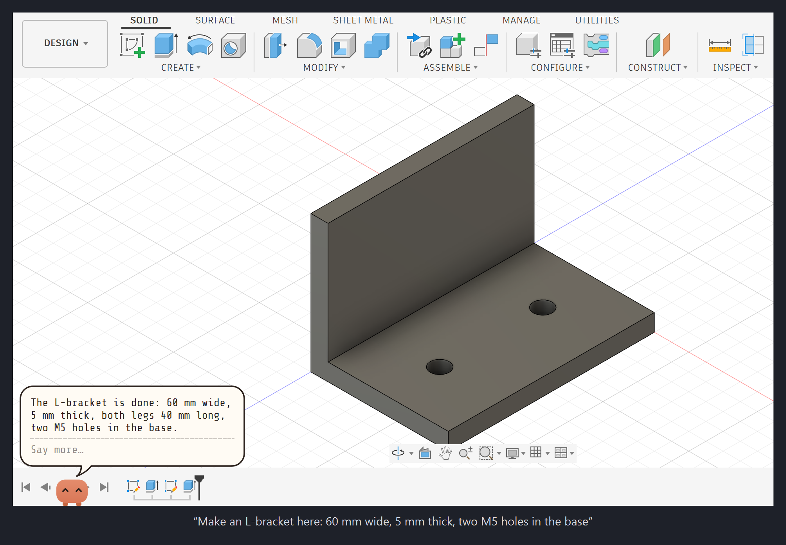

# Desk Pet

**English** | [简体中文](README.zh-CN.md)

A tiny pet on the bottom edge of your screen. Click it and talk to Claude Code in its speech bubble.



## Download

1. Install [Claude Code](https://code.claude.com/docs/en/quickstart) and sign in, so that `claude` runs in a terminal
2. Download the zip for your system from the [latest release](../../releases/latest), unzip it and run **DeskPet**
3. The first time you ask it something, a terminal opens and Claude Code asks whether to trust its folder (`~/Claude`): say yes

Windows: if it says "Windows protected your PC", click **More info** → **Run anyway**.
macOS and Linux haven't been tested yet. On macOS, Ctrl+Alt+Space needs the Accessibility permission.

Or run it from the source (Python 3.10+):

```
git clone https://github.com/wenjun-cheng/desk-pet && cd desk-pet
python -m venv .venv
.venv/bin/pip install -r requirements.txt     # Windows: .venv\Scripts\pip install -r requirements.txt
.venv/bin/python run.py                       # Windows: .venv\Scripts\pythonw run.py
```

## Features

- Click it or press Ctrl+Alt+Space: a speech bubble to type to Claude Code, and its answer
- Claude sees the window you were in ("make this bigger") and can work in Adobe Illustrator
- And in Autodesk Fusion: turn on **Preferences → General → API → Fusion MCP Server** there
- It asks in the bubble before doing something; answer in your own words ("no, rename it instead")
- Double-click: the whole conversation in a terminal
- Right-click: model, context and plan usage, a new conversation, English or 中文
- Drag it anywhere along the bottom edge; it naps while you're away
