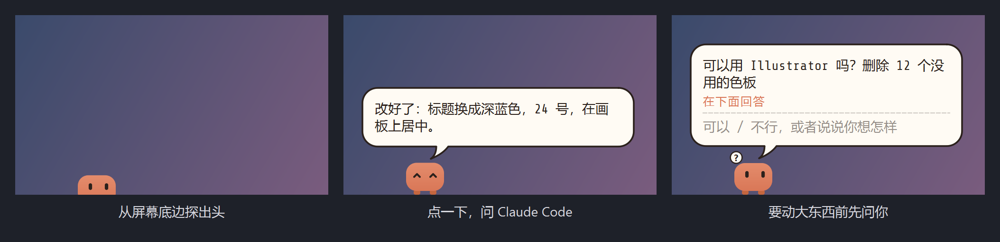

# 桌宠

[English](README.md) | **简体中文**

屏幕底边的一只小桌宠。点它一下，就能在它的对话气泡里和 Claude Code 说话。



## 下载

1. 先安装 [Claude Code](https://code.claude.com/docs/en/quickstart) 并登录，确保在终端里能运行 `claude`
2. 到[最新版本](../../releases/latest)下载对应系统的 zip，解压后运行 **DeskPet**
3. 第一次问它问题时会打开一个终端，Claude Code 会问是否信任它的文件夹（`~/Claude`），选「是」

Windows：如果提示「Windows 已保护你的电脑」，点「更多信息」→「仍要运行」。
macOS 和 Linux 还没有实际测试过。macOS 上 Ctrl+Alt+Space 需要「辅助功能」权限。

也可以从源码运行（Python 3.10 以上）：

```
git clone https://github.com/wenjun-cheng/desk-pet && cd desk-pet
python -m venv .venv
.venv/bin/pip install -r requirements.txt     # Windows：.venv\Scripts\pip install -r requirements.txt
.venv/bin/python run.py                       # Windows：.venv\Scripts\pythonw run.py
```

## 功能

- 单击或按 Ctrl+Alt+Space：弹出对话气泡，输入给 Claude Code，回答也显示在里面
- Claude 能看到你刚才所在的窗口（「把这个放大」），还能直接操作 Adobe Illustrator
- 要做事之前会在气泡里问你，用自己的话回答就行（「别删，改名就好」）
- 双击：在终端里打开完整对话
- 右键：模型、上下文和额度用量，开新话题，English / 中文
- 可以拖到底边任何位置；你不在时它会打个盹
